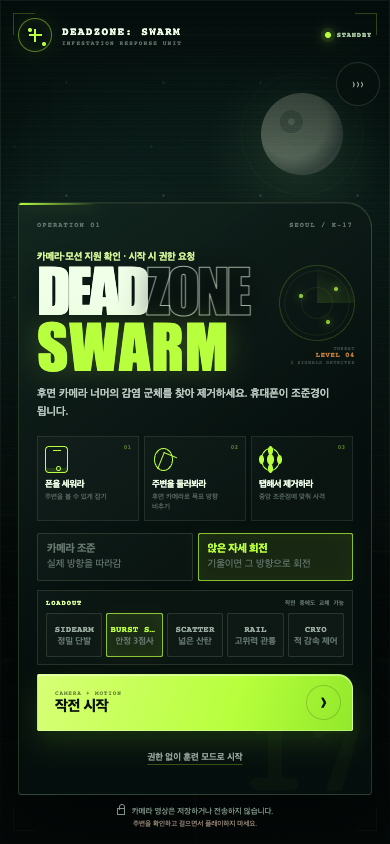
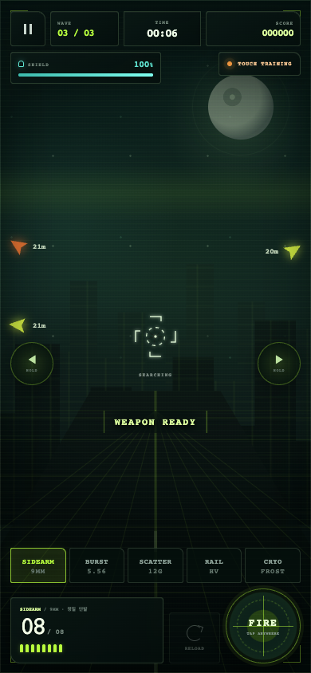
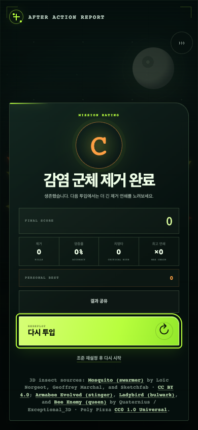
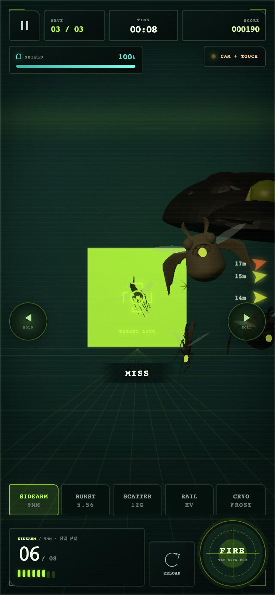

# DEADZONE: SWARM

[](https://github.com/khjn81/deadzone-ar/actions/workflows/ci.yml)

모바일 브라우저에서 카메라 화면 위 감염 곤충을 조준하는 AR 슈팅 프로토타입입니다. 카메라·방향 센서가 없어도 드래그와 터치로 훈련할 수 있습니다. 90초 작전,5종 무기, 웨이브·치명타·콤보·결과 기록을 구현했습니다.

| 대기 화면 | 전투 화면 | 작전 결과 |
| --- | --- | --- |
|  |  |  |

최대 부하 검증 장면입니다. 합성 카메라 배경과 고정된6개체·4사체·효과 풀을 사용하는 그래픽 테스트에서 캡처했습니다.



## 실행

Node22.22.2와 npm을 기준으로 검증합니다. 계정이나 API 키는 필요하지 않습니다.

```sh
npm ci --ignore-scripts --no-audit --no-fund
npm run dev
# http://localhost:3000/game/index.html
```

배포 빌드는 `npm run build` 후 `npm run start`로 실행합니다. 원래 Next/React/Vinext·Cloudflare 래퍼를 유지했고, 게임 자체는 `public/game/`의 정적 HTML/CSS/ES modules입니다. `.openai/hosting.json`은 d1/r2가 null인 공개 개발용 설정입니다. 실제 호스팅 계정·바인딩 정보는 포함하지 않습니다.

카메라·센서는 HTTPS 또는 localhost 보안 컨텍스트가 필요합니다. 로컬 서버를 다른 기기에서 여는 것만으로 카메라가 허용되지는 않습니다. 카메라 영상은 브라우저의 video 레이어로 표시하며 저장하거나 서버로 전송하지 않습니다.

## 조작

- 훈련 모드: 화면 드래그로 조준하고 화면 또는 FIRE로 사격합니다.
- SEATED TURN: 중립 자세에서 좌우로 기울이면 회전하며, CAMERA AIM은 휴대폰의 카메라 방향으로 조준합니다.
- 좌우 HOLD 버튼: 짧게 누르면7도 보정, 길게 누르면 연속 회전합니다. Enter·Space로도 버튼을 사용할 수 있습니다.
- 전투 캔버스에 포커스가 있을 때 Space는 사격, R은 재장전입니다. Escape는 일시정지·재개입니다.
- 무기를 바꾸면 각각의 탄창을 유지합니다. SIDEARM, BURST, SCATTER, RAIL, CRYO가 서로 다른 투사·피해·상태 효과를 갖습니다.

탭 숨김·창 이탈·가로 화면 안내에서는 작전이 멈춥니다. 숨긴 페이지의 카메라는 종료하며, 돌아온 뒤 직접 재연결할 수 있습니다. 일시정지 창은 배경 입력을 막고 키보드 포커스를 관리합니다. 브라우저 뒤로 가기 캐시에서도 수동 재개할 수 있습니다.

## 검증과 개선 기록

공개 준비 과정에서27회의 가설·변경·평가 루프를 수행했습니다. 설치·테스트 설정은 회차에 포함하지 않습니다. [루브릭](quality/rubric.json), [채택한 개선 목록](docs/improvements.md), [실험별 평가](quality/experiments.json), [검증 범위](docs/verification.md)를 함께 공개합니다. 점수는 구현 에이전트의 판단이며 독립적인 사용자 평가를 뜻하지 않습니다.

```sh
npx playwright install chromium webkit
npm test                         # 자산 재생성/해시, 캐시 버전, 전체 빌드와263개 검사
npm run test:e2e                  # desktop/mobile 핵심·복구24개씩
npm run test:release              # 실제 배포 빌드, Chromium·터치·WebKit, 오프라인·WebGL 손실
npm run test:graphics             # 실제 GLB/PBR/쉐이더·자원 상한·성능 검사
npm run verify:clean              # 의존성 없는 소스 복사본에서 새 설치·전체 검사
```

GitHub Actions는 새 lockfile 설치 후 동일 검사를 실행하고 JSON·스크린샷 증거를 아티팩트로 남깁니다. 테스트 재시도는0회입니다. 빠른 브라우저 검사는 기존 옵션 `?training=1&duration=8&seed=7&diagnostics=1`로 실제8초 작전을 완료합니다. 결과를 강제로 만드는 QA 함수는 이 사용 흐름 검사에서 호출하지 않습니다. 별도 그래픽 스트레스 검사는 의도적으로 최대 장면을 주입하며 이를 사용자 흐름 검사와 구분합니다.

오프라인 셸은 첫 온라인 방문에서 설치됩니다. 게임 파일을 수정한 뒤에는 `npm run cache:stamp`를 실행해 내용 기반 캐시 버전을 함께 커밋하세요. 버전이 맞지 않으면 빌드가 실패합니다. 처음부터 오프라인인 브라우저에서는 설치할 수 없습니다.

## 구현과 남은 범위

Canvas2D가 UI·조준·투영을 맡고, 하나의 Three.js WebGL 컨텍스트가4종 곤충 모델과 제한된 효과 풀을 그립니다. 모델 하나의 실패는 종별 절차적 모델로, 전체 WebGL 실패는 Canvas 전투로 복구합니다. [구조·무기·모델 설명](public/game/README.md)에 자원 상한을 정리했습니다.

실제 카메라 하드웨어, iPhone/Android의 권한 UI·방향 센서, 장시간 발열·배터리는 아직 실기기 검증이 필요합니다. 카메라 자동 검사는 캔버스에서 만든 합성 MediaStream을 사용합니다. 지면 인식·위치 추적·공간 앵커는 구현하지 않았습니다. 표시 지연이2초를 넘으면 시간을 버리는 대신 작전을 일시정지합니다. 모바일 브라우저의 설치·센서 지원 차이도 남아 있습니다.

자작 코드는 [MIT](LICENSE)이며, 모델과 Three.js의 별도 라이선스는 [THIRD_PARTY.md](THIRD_PARTY.md)를 따릅니다.
